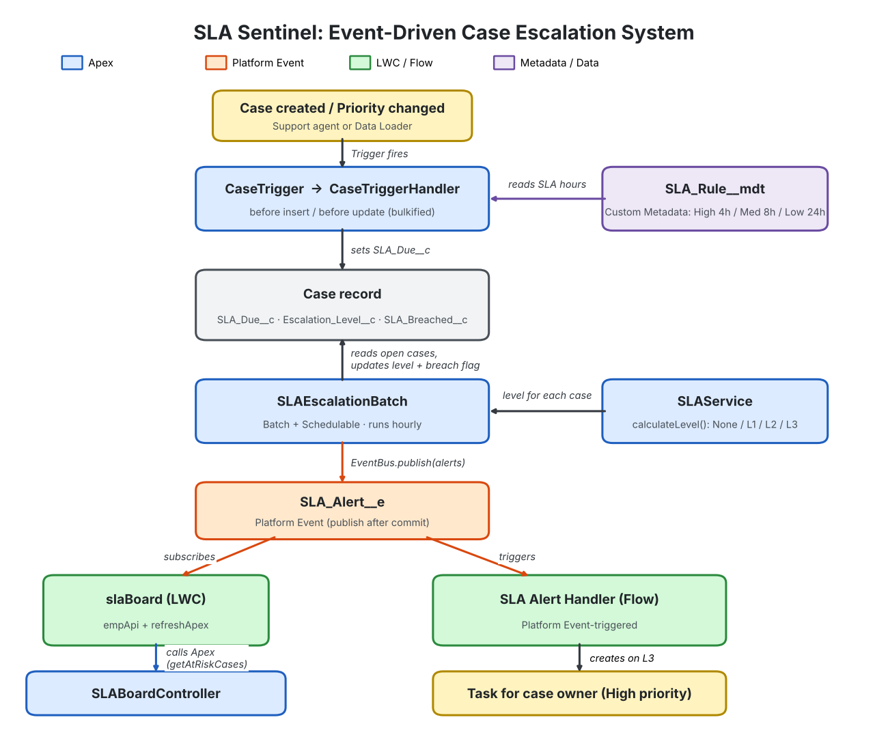
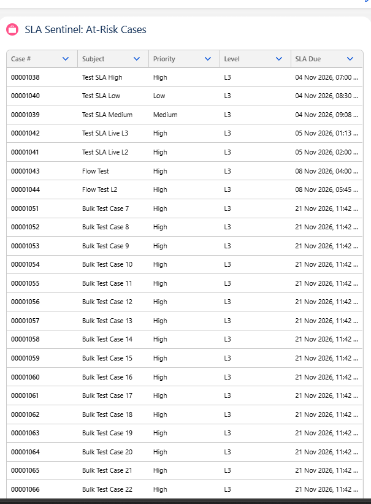
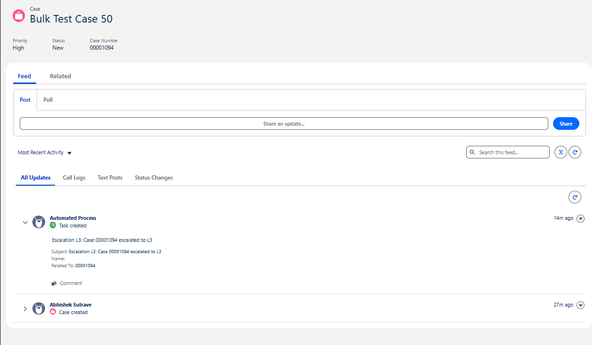
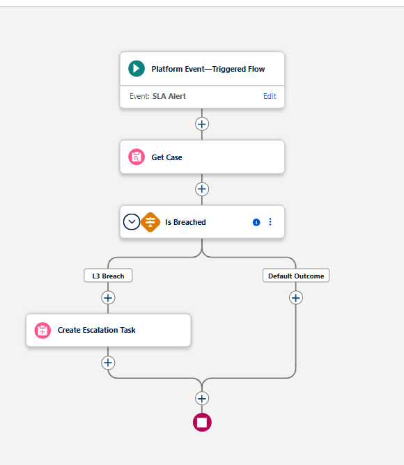
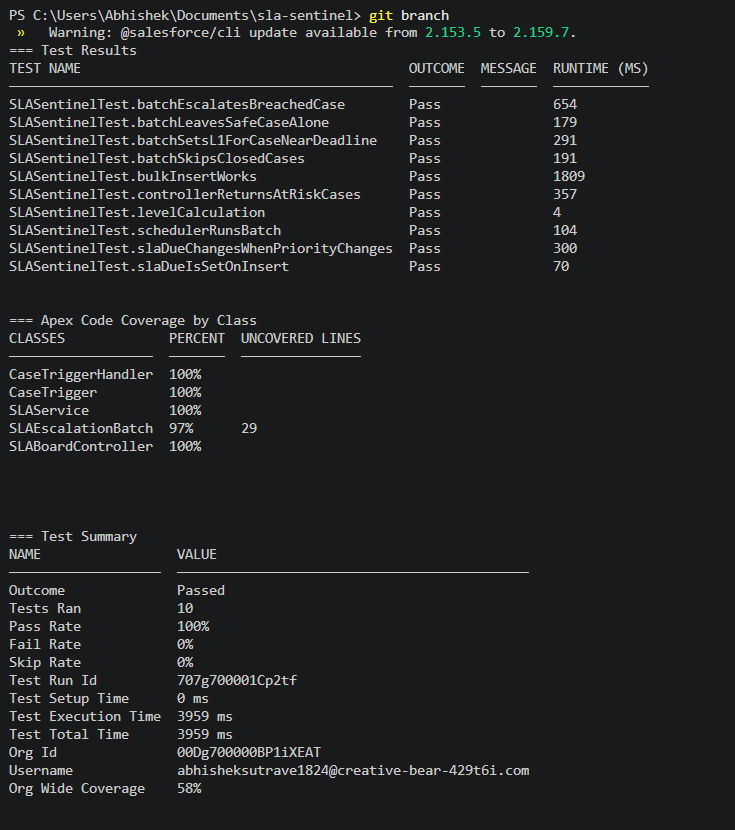
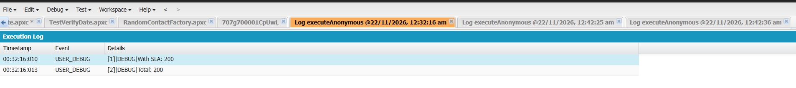

# SLA Sentinel: Event-Driven Case Escalation System

A Salesforce project that automatically sets SLA deadlines on Cases, escalates at-risk cases every hour, and alerts the team in real time.

## Problem
Support teams miss SLAs because nobody notices a case is about to breach until it is too late. SLA Sentinel watches every open Case and escalates it automatically.

## How it works
1. A Case is created -> a trigger sets `SLA_Due__c` based on Priority (rules stored in Custom Metadata).
2. An hourly Batch job checks open Cases and sets Escalation Level: **L1** (2h left), **L2** (1h left), **L3** (breached).
3. Each escalation publishes a **Platform Event** (`SLA_Alert__e`).
4. An **LWC board** subscribes to the event and refreshes live.
5. A **Platform Event-triggered Flow** creates a High-priority Task for the Case owner on L3.

## Architecture


## Tech stack
Apex (Triggers, Batch, Schedulable), SOQL, Lightning Web Components, Platform Events, Flow, Custom Metadata Types, Salesforce CLI, Git/GitHub

## Features
- Bulkified Case trigger using the handler pattern
- SLA hours configurable by admins via Custom Metadata (no code change)
- Hourly Batch Apex escalation with breach flag
- Live LWC dashboard using `lightning/empApi` and `refreshApex`
- Auto-created Tasks on breach via Flow
- 11 Apex tests, 97%+ coverage on all project classes, including a 200-record bulk test

## Screenshots
| Live board | Auto-created task |
|---|---|
|  |  |

| Flow | Tests and coverage |
|---|---|
|  |  |

Bulk test: 200 Cases imported with Data Loader, all received an SLA deadline.



## Setup
1. Install Salesforce CLI and VS Code with the Salesforce Extension Pack
2. Clone the repo and login to your org:
```bash
git clone https://github.com/AirAbhiii/sla-sentinel.git
cd sla-sentinel
sf org login web --alias devorg --set-default
```
3. Deploy:
```bash
sf project deploy start
```
4. Add the `slaBoard` component to the Home page (Setup > Edit Page).
5. Activate the `SLA Alert Handler` flow.
6. Schedule the job in Execute Anonymous:
```apex
System.schedule('SLA Sentinel Hourly', '0 0 * * * ?', new SLAEscalationBatch());
```
7. Run tests:
```bash
sf apex run test --tests SLASentinelTest --result-format human --code-coverage --wait 10
```

## Author
Abhishek Sutrave | [LinkedIn](https://www.linkedin.com/in/abhishek-s-6168ba427/) | [GitHub](https://github.com/AirAbhiii)